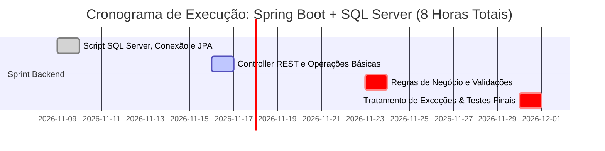
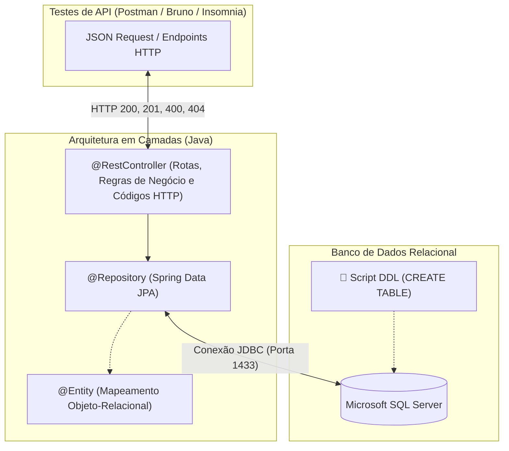

# Guia de Projetos Práticos: Spring Boot API REST com Microsoft SQL Server (1 Entidade)

**Duração Total:** 8 Horas (4 encontros de 2 horas)  
**Nível:** Ensino Médio / Técnico  
**Foco:** Backend Completo em Java com Spring Boot e Microsoft SQL Server (DDL SQL, Entity, Repository, Controller, Validações e Regras de Negócio)

---

## 📅 Cronograma de Entregas por Aula (4 Semanas / 2h por Encontro)

O cronograma foi planejado para que compreendam todo o fluxo de engenharia de software no backend, iniciando pela **modelagem relacional em SQL Server** (escrita e execução de scripts DDL manuais) até a integração com Spring Data JPA, regras de negócio e testes via cliente HTTP.



### Aula 1 — 09/11: Script SQL Server, Conexão e Mapeamento JPA
* **Objetivo:** Criar a tabela no Microsoft SQL Server via script DDL, configurar o Spring Boot para conectar ao SQL Server e mapear a `@Entity` correspondente.
* **Entregáveis:**
  * **Script DDL SQL Server (`schema.sql`):** Criação da tabela com tipos nativos do SQL Server (`BIGINT IDENTITY(1,1)`, `VARCHAR`, `DATETIME2`, `BIT`, `DECIMAL`), chaves primárias e restrições `NOT NULL`.
  * Criação do projeto Spring Boot com as dependências: `Spring Web`, `Spring Data JPA`, `MS SQL Server Driver` (`com.microsoft.sqlserver:mssql-jdbc`), `Lombok` e `Validation`.
  * Configuração do `application.properties` com URL de conexão JDBC do SQL Server (`jdbc:sqlserver://...`), usuário, senha e `spring.jpa.hibernate.ddl-auto=validate` (garantindo que o script criado seja respeitado).
  * Classe `@Entity` mapeada com `@Table`, `@Id`, `@GeneratedValue(strategy = GenerationType.IDENTITY)` e anotações `@Column`.
  * Interface `Repository` estendendo `JpaRepository<Entidade, Long>`.
  * Aplicação iniciando com conexão estabelecida e validada com o SQL Server.

### Aula 2 — 16/11: Camada Web e Operações CRUD Básicas
* **Objetivo:** Implementar o `@RestController` e expor as operações fundamentais de leitura, inserção e remoção integradas ao SQL Server.
* **Entregáveis:**
  * Classe `@RestController` com anotação `@RequestMapping("/api/...")`.
  * Endpoint `GET` para listagem completa retornando `ResponseEntity<List<Entidade>>`.
  * Endpoint `GET /{id}` para busca individual com verificação de existência (`Optional` ou `orElseThrow`).
  * Endpoint `POST` para criação inicial do registro (`HttpStatus.CREATED`) persistindo no SQL Server.
  * Endpoint `DELETE /{id}` com retorno `HttpStatus.NO_CONTENT`.
  * Coleção de requisições criada e validada no Postman, Insomnia ou Bruno.

### Aula 3 — 23/11: Regras de Negócio
* **Objetivo:** Implementação da regra central do tema.
* **Entregáveis:**
  * Implementação da **Regra de Negócio** (cálculos automáticos, validações lógicas e transições de status).
  * Endpoint específico exposto no Controller (`PATCH` ou `POST` de ação) invocando a regra de negócio.

### Aula 4 — 30/11: Validações, Tratamento de Erros e Homologação
* **Objetivo:** Implementar validações e finalizar os testes integrados.
* **Entregáveis:**
  * Validações de entrada na requisição (`NotNull`, `NotBlank`, `Min`, `Max`, etc).
  * Retorno de status `400 Bad Request` ou `409 Conflict`.
  * Bateria de testes com cenários de sucesso (status 200/201) e cenários de falha da regra de negócio (status 400/404/409).

---

### 1. Configuração do `application.properties`
```properties
# Conexão com Microsoft SQL Server
spring.datasource.url=jdbc:sqlserver://localhost:1433;databaseName=EscolaDB;encrypt=true;trustServerCertificate=true
spring.datasource.username=sa
spring.datasource.password=SuaSenhaForte123!
spring.datasource.driver-class-name=com.microsoft.sqlserver.jdbc.SQLServerDriver

# Hibernate / JPA
# "validate" valida se o script DDL executado no SQL Server confere exatamente com as anotações Java
spring.jpa.hibernate.ddl-auto=validate
spring.jpa.show-sql=true
spring.jpa.properties.hibernate.format_sql=true
spring.jpa.properties.hibernate.dialect=org.hibernate.dialect.SQLServerDialect
```

---

## 🏛️ Arquitetura de Camadas Esperada no Projeto



---

## 🚀 O Projeto Prático com Script SQL Server e Regras de Negócio

---

### 9. Registro de Ocorrências e Faltas Justificadas
* **Contexto:** Envio e controle de atestados médicos ou declarações de trabalho pelos alunos para a coordenação.
* **Entidade:** `JustificativaAusencia`
  * Atributos: `id` (Long), `matriculaAluno` (String), `motivo` (String: `SAUDE`, `TRABALHO`, `LUTO`, `OUTRO`), `dataInicio` (LocalDate), `diasAfastamento` (Integer), `dataFim` (LocalDate), `status` (String: `EM_ANALISE`, `ACEITO`, `RECUSADO`)
* **Script DDL para SQL Server:**
```sql
CREATE TABLE tb_justificativa_ausencia (
    id BIGINT IDENTITY(1,1) PRIMARY KEY,
    matricula_aluno VARCHAR(30) NOT NULL,
    motivo VARCHAR(20) NOT NULL,
    data_inicio DATE NOT NULL,
    dias_afastamento INT NOT NULL,
    data_fim DATE NOT NULL,
    status VARCHAR(20) NOT NULL DEFAULT 'EM_ANALISE'
);
```
* **Endpoints:**
  * `GET /api/justificativas` — Lista todas as justificativas.
  * `GET /api/justificativas/{id}` — Consulta justificativa por ID.
  * `POST /api/justificativas` — **Regra de Negócio no Cadastro:** Calcula automaticamente `dataFim = dataInicio + diasAfastamento - 1`.
  * `PUT /api/justificativas/{id}` — Ajusta dados da justificativa.
  * `DELETE /api/justificativas/{id}` — Exclui registro.
  * `PATCH /api/justificativas/{id}/parecer` — Parecer da secretaria (`ACEITO` ou `RECUSADO`).
* **Pseudocódigo da Regra de Negócio:**
```text
FUNCAO registrarJustificativa(dados):
    SE dados.diasAfastamento <= 0 ENTAO:
        LANCAR_ERRO("O período de afastamento deve ser de no mínimo 1 dia.")
    FIM_SE

    dados.dataFim = dados.dataInicio + (dados.diasAfastamento - 1) DIAS
    dados.status = "EM_ANALISE"

    RETORNAR salvar(dados)
FIM_FUNCAO
```

---
